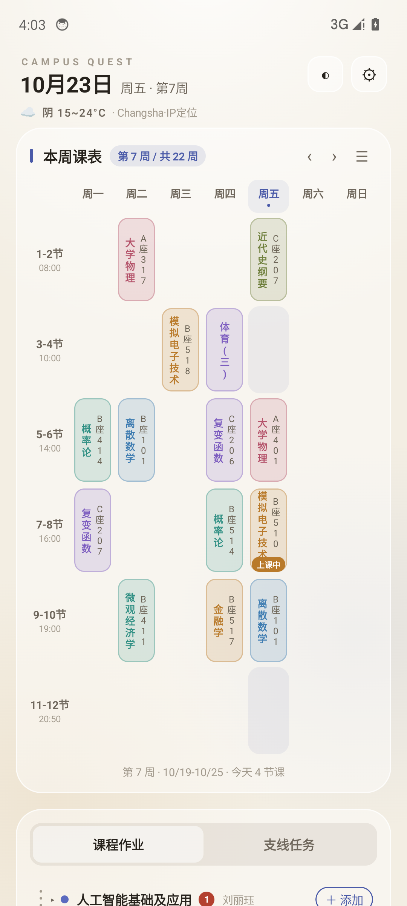
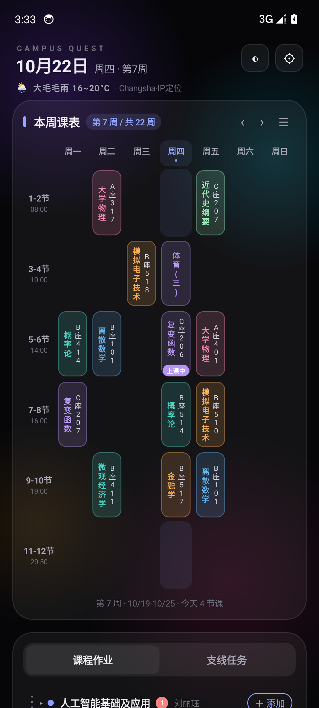
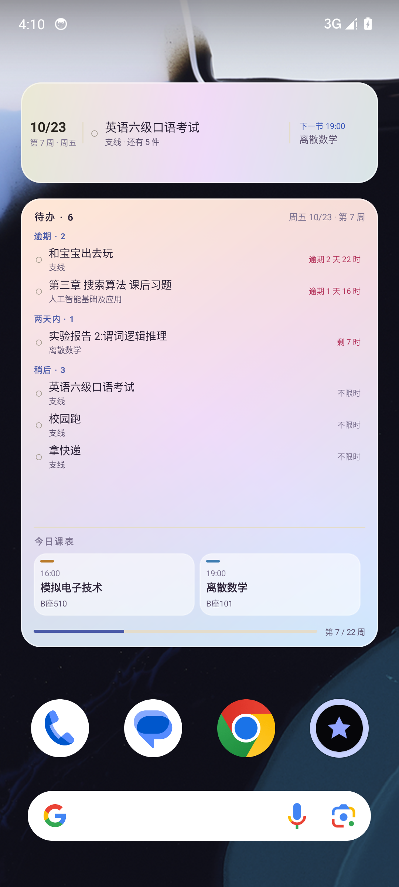
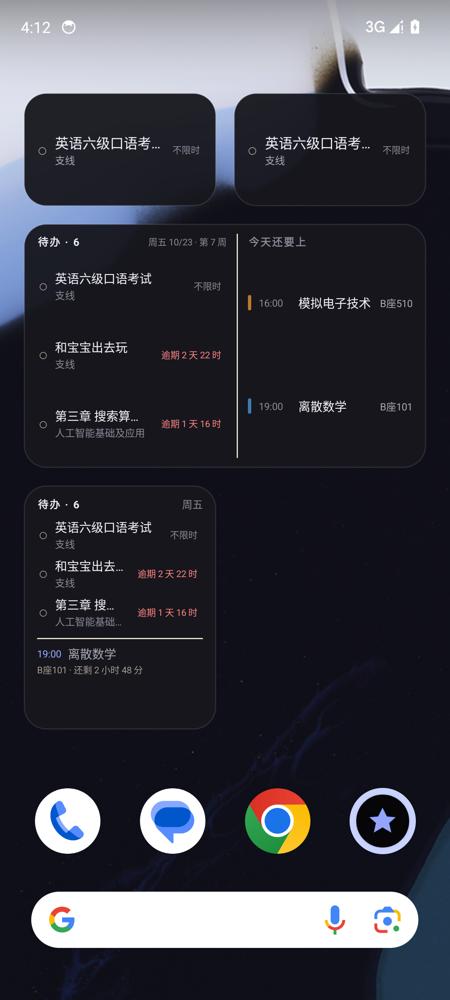
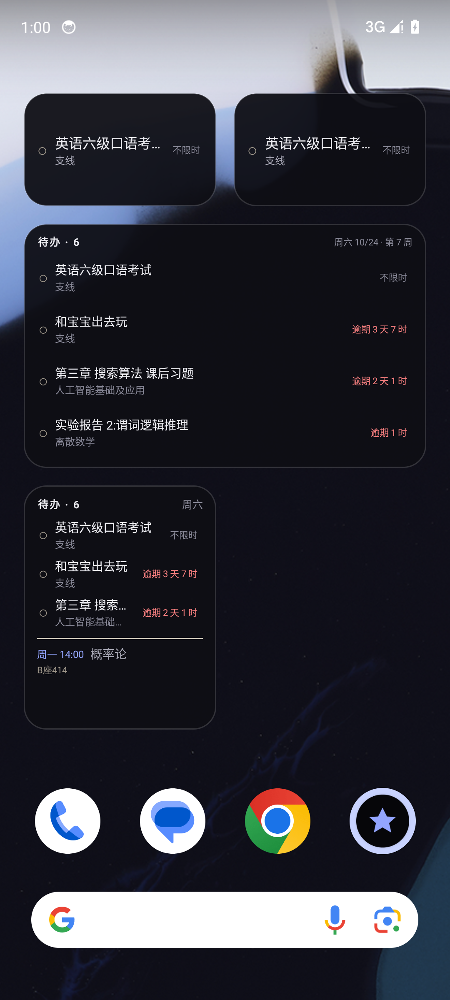

# CampusQuest · 课程表 × 待办

> 一个给自己用的大学课表 + 任务清单 App。Kotlin + Jetpack Compose,单 Activity、无后端、数据全在本地。
> 玻璃质感的奶油纸配色,深色模式,六种尺寸的桌面小组件。

<p>
  
  
  
</p>

## 它解决什么

学校发的课表是一张 Excel/截图,教务系统又只在电脑上好用。真正每天要回答的其实就三个问题:
**今天上什么课、下一节在哪、哪件作业快到期了。** 所以这个 App 只有两块:

- **本周课表**:改到自己手上的 18 条真实课程,周次、单双周、教室都在;自动算当前第几周、今天几节课、哪节课正在上。
- **课程作业 / 支线任务**:作业按课程自动分组,倒计时按紧急度变色(逾期 / 6 小时内 / 48 小时内 / 常态);支线任务可以置顶(带流动灯带),也可以拖动排序。

## 功能

| | |
|---|---|
| 课表 | 22 周校历、自定义开学日期与总周数、翻周、单双周、上课中标记、竖排课程名 |
| 任务 | 作业/支线双页签、按课程分组、可折叠、倒计时分色、置顶、长按删除、拖动排序(可跨多格) |
| 题记 | 支线任务的「一句题记」由 14 类正则模板生成(跑步/快递/作业/考试/约会…),可重铸 |
| 导入 | **Excel(.xls/.xlsx)**:走内置 WebView + SheetJS 解析,自动识别表头/合并单元格;<br>**照片**:ML Kit 中文 OCR + 像素网格重建(自动找线框、按列推星期) |
| 天气 | Open-Meteo + IP 定位(手动城市 > GPS > IP 定位),顶部一行当前天气 |
| 数据 | JSON 导出/导入、每日自动快照(留 7 份)、Room v1→v2 迁移 |
| 小组件 | 6 种尺寸(2×1 / 2×2 / 4×1 / 4×2 / 4×4 / 5×4),四套外观(跟随系统 / 浅色 / 深色 / 彩虹) |
| 主题 | 浅色纸面 / 深色碳黑,按时间自动切换(18:00–06:00),长按 ◐ 恢复自动 |

## 小组件

待办优先、课表次之:先按「置顶 → 逾期 → 今天 → 48 小时内 → 更远 → 不限时」排序,课表退到第二层。




- 点圆圈 = 直接完成该任务;点整行 = 打开 App 对应页签;点空白 = 打开 App。
- 刷新:数据变更后 300ms 合并刷新、完成动作即时刷新、外加 `updatePeriodMillis` 30 分钟兜底。
- 电脑上预览外观:`docs/widget-themes-0.4.2.html`(浏览器直接打开,可切浅色/深色/彩虹)。

## 构建

```bash
# 需要 JDK 17 + Android SDK 34
export JAVA_HOME=/path/to/jdk-17
echo "sdk.dir=/path/to/Android/Sdk" > local.properties
./gradlew assembleRelease
# 产物:app/build/outputs/apk/release/app-release.apk
```

本仓库用 Windows 开发,实际用的是 `gradle assembleRelease`(Gradle 8.9 / AGP 8.5.2 / Kotlin 1.9.24 / Compose BOM 2024.06)。

`app/build.gradle.kts` 里 release 用的是 `keystore/cq-release.keystore`(见 [keystore/README.md](keystore/README.md))。
只想跑起来的话,`./gradlew assembleDebug` 就够了,不需要 keystore。

## 项目结构

```
app/src/main/java/com/campusquest/app/
├── MainActivity.kt            单 Activity 入口 + 小组件 pin 的 intent 处理
├── data/                      Room(Db/Seed) + DataStore(Prefs)
├── logic/                     日历与周次、题记生成、天气、导入解析、备份
├── theme/                     CqColors 设计令牌(浅/深两套)
├── ui/                        AppRoot / 课表 / 任务 / 弹层 / 玻璃质感
├── vm/                        AppViewModel(单例状态机)
└── widget/                    RemoteViews 小组件:数据、渲染、主题、点击接收器
app/src/main/assets/           parser.html + xlsx.full.min.js(Excel 解析)
docs/                          设计稿、截图、安装说明
```

## 几个刻意的技术选择

- **小组件用 RemoteViews 而不是 Glance**:Glance 会把 compose runtime 拉到 1.7,与工程现有 Compose 1.6 冲突;而六种尺寸都是「文字 + 色块 + 细线」,RemoteViews 够用,出问题也好定位。
- **Excel 走 WebView + SheetJS**:Apache POI 在 Android 上体积和兼容性都不划算。
- **输入框用原生 `EditText` 桥接**:某些 ROM(红魔等)上 Compose 的输入会话通道失效,键盘能弹但字符无处可去;改用平台原生 EditText 后 IME/光标/会话全部走系统路径。
- **背景不用噪点 `ImageShader` + `BlendMode`**:高级混合模式要求 Skia 整块离屏回读,部分 Adreno GPU 上会把字形图集弄花(表现为滚屏时闪白字)。现在背景是一次静态绘制。

## 版本

| 版本 | 内容 |
|---|---|
| 0.2.x | 视觉还原、导入管线、时间自动深色、输入法方案改成原生 EditText |
| 0.3.0 | 修「取消置顶闪白」、课程分组/支线任务排序 |
| 0.3.1 / 0.3.2 | 拖动重写(可跨多格、邻居带弹簧动画、不透明拖起层) |
| 0.3.3 | 空课程显示「无」 |
| 0.3.4 | **数据地基**:JSON 导出/导入、每日快照、Room v1→v2 迁移 |
| 0.4.0 | **六种桌面小组件** |
| 0.4.1 | 修「滚动时闪白字」+ 浅色灰框,小组件信息量加量(4×1 标题、4×2 满行、4×4 三行) |
| 0.4.2 | 修浅色面板灰框、小组件四套外观、修「下一节课」日期标签(不再一律写「明天」) |

## 许可

MIT,见 [LICENSE](LICENSE)。

课程数据来自作者本校 2026–2027 学年第一学期,仅作示例;`Seed.kt` 里换成你自己的即可。
